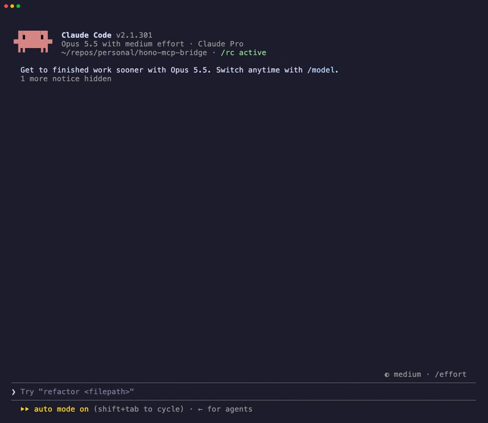

# hono-mcp-bridge

**Turn your existing [Hono](https://hono.dev) API into an [MCP](https://modelcontextprotocol.io) server for Claude, Cursor and other AI agents. Change one import, keep your routes.**

[](https://www.npmjs.com/package/hono-mcp-bridge)
[](https://github.com/serikshaikamalov/hono-mcp-bridge/actions/workflows/ci.yml)
[](LICENSE)

```diff
- import { zValidator } from '@hono/zod-validator'
+ import { zValidator, mountMcp } from 'hono-mcp-bridge'

  app.get('/tours', zValidator('query', z.object({ month: z.coerce.number() })), (c) => ...)
  app.post('/bookings', zValidator('json', BookingSchema), (c) => ...)

+ mountMcp(app)   // → POST /mcp: every route is now a tool
```

Your zod schemas become the tools' input schemas. Calls go through your real routes, so validation, auth middleware and logging work exactly as they do for HTTP clients.



## Install

```sh
npm i hono-mcp-bridge     # or: bun add / pnpm add
```

Peer dependencies: `hono >= 4.6`, `zod >= 4`, `@hono/zod-validator`.
Runs anywhere Hono runs: Bun, Node, Deno, Cloudflare Workers, Vercel.

## Example

```ts
import { Hono } from 'hono'
import { z } from 'zod'
import { describeTool, mountMcp, zValidator } from 'hono-mcp-bridge'

const app = new Hono()

app.get(
  '/tours',
  describeTool('Search tours by departure month and maximum price in USD.'),
  zValidator('query', z.object({
    month: z.coerce.number().min(1).max(12).describe('Departure month, 1-12'),
    maxPrice: z.coerce.number().optional(),
  })),
  (c) => c.json(searchTours(c.req.valid('query'))),
)

app.get('/admin/stats', describeTool({ hidden: true }), (c) => ...)  // never shown to agents

mountMcp(app, { name: 'Tours API' })

export default app
```

The agent sees:

| Tool        | Input                                             |
| ----------- | ------------------------------------------------- |
| `get_tours` | `{ query: { month: number, maxPrice?: number } }` |

Full runnable version: [`examples/tours.ts`](examples/tours.ts) (`bun run example`).

## Connect an agent

**Claude Code**

```sh
claude mcp add --transport http tours http://localhost:3000/mcp
```

**Cursor** (`.cursor/mcp.json`)

```json
{ "mcpServers": { "tours": { "url": "http://localhost:3000/mcp" } } }
```

**Claude Desktop** (`claude_desktop_config.json`)

```json
{
  "mcpServers": {
    "tours": { "command": "npx", "args": ["mcp-remote", "http://localhost:3000/mcp"] }
  }
}
```

**Debug** with the [MCP Inspector](https://github.com/modelcontextprotocol/inspector): `npx @modelcontextprotocol/inspector`.

## How routes become tools

| Route       | Tool                                                                                                                                                                      |
| ----------- | ------------------------------------------------------------------------------------------------------------------------------------------------------------------------- |
| Name        | `describeTool({ name })`, otherwise `GET /tours/:id` → `get_tours_by_id`                                                                                                  |
| Description | `describeTool('...')`, otherwise `GET /tours/:id`. Write it for the agent: it decides when to call the tool from this text                                                |
| Input       | `{ params, query, body }` from `zValidator('param' \| 'query' \| 'json', schema)`. Path params without a validator are derived from the path                              |
| Annotations | `GET` → `readOnlyHint`; `DELETE` → `destructiveHint`                                                                                                                      |
| Result      | Response body as text, plus `structuredContent` for JSON objects. Non-2xx responses are returned with `isError: true`, so the agent can read a validation error and retry |

## Options

```ts
mountMcp(app, {
  path: "/mcp", // endpoint path
  name: "Tours API",
  version: "1.0.0",
  instructions: "Prices are in USD.", // sent to the agent on connect
  include: ["/tours*", "/bookings*"], // path globs to expose (default: all)
  exclude: ["/admin/*"], // path globs to hide
  methods: ["GET"], // read-only API for agents
  forwardHeaders: ["authorization", "cookie"], // copied onto each tool call
  allowedOrigins: ["https://app.example.com"], // reject other Origin headers
});
```

Lower-level pieces: `createMcpHandler(app, options)` returns a plain Hono handler to mount yourself; `collectTools(app, options)` returns the tool list.

## Security

Agents act with the credentials of whoever connected them. Before exposing an API:

- Expose only what an agent should do. Prefer `include` over `exclude`, and consider `methods: ['GET']` to start.
- Keep auth on your routes. The bridge forwards `Authorization` and `Cookie` from the MCP request, so your existing middleware decides.
- When serving on `localhost`, set `allowedOrigins` to block DNS-rebinding attacks from web pages.

## How it compares

- [`hono-mcp-server`](https://www.npmjs.com/package/hono-mcp-server): you wrap each route in `registerTool()` with a separate input schema. Here the schema you already validate with is reused.
- [`hono-gql-mcp`](https://github.com/KLR-Pattern/hono-gql-mcp): exposes one GraphQL tool derived from `@hono/zod-openapi`. Here every route is its own tool and plain `Hono` works.
- [`@hono/mcp`](https://www.npmjs.com/package/@hono/mcp): MCP transport only; you define tools by hand.

## Limitations

- Transport is Streamable HTTP in stateless JSON mode: no server-initiated messages, SSE streams or sessions. Tool calls are request/response, which is what a REST route is.
- Only zod v4 schemas are converted. `form`, `header` and `cookie` validators are not bridged yet.
- If a sub-app with its own `onError` is mounted via `app.route()`, Hono wraps its handlers and the schemas can't be read. Mount the bridge on that sub-app or use `describeTool` + path params.

## Roadmap

- [ ] `@hono/zod-openapi` (`OpenAPIHono`) and `hono-openapi` support
- [ ] Valibot / ArkType via Standard Schema
- [ ] `outputSchema` from response schemas
- [ ] stdio transport for local servers

Contributions welcome. See [CONTRIBUTING.md](CONTRIBUTING.md).

## License

MIT

## Test
